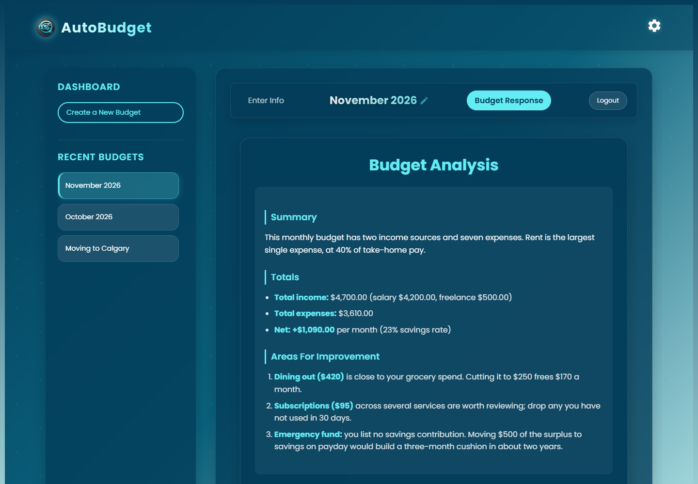
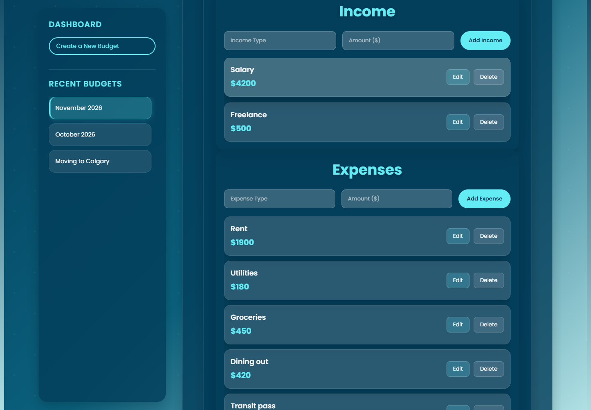
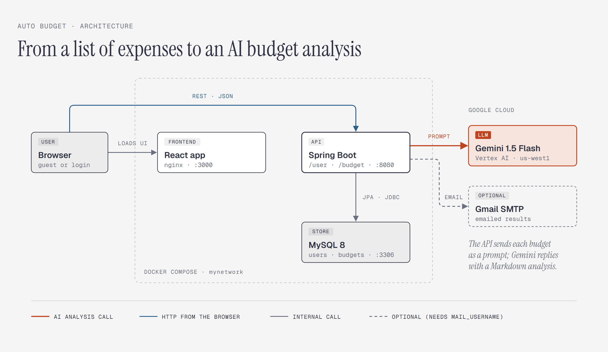

# Auto Budget – Smart Financial Management

Auto Budget is a full-stack budgeting app. You list your income and expenses for a day, month or year, and Google's Gemini model reads the budget and writes back a summary, your totals, and three concrete ways to improve it. It has a React frontend, a Spring Boot REST API, and a MySQL database.



## What It Does

1. **Enter a budget.** Pick daily, monthly or yearly, then add each income source and expense with its amount.
2. **Generate an analysis.** The API turns the budget into a prompt for Gemini 1.5 Flash (on Vertex AI) and shows the Markdown reply: a summary, total income, expenses and net, and three areas to improve.
3. **Keep your budgets.** Signed-in users get their budgets saved to a sidebar to reopen, rename or regenerate. Guests can generate an analysis without an account; nothing is saved.
4. **Get it by email (optional).** If Gmail is configured, the analysis can be emailed to you.

## Screenshots

| Enter income and expenses | Home page |
|---|---|
|  |  |

The screenshots use sample data.

## Architecture



- **Browser → React app.** nginx serves the built React app on port 3000. The page then calls the API directly at `http://localhost:8080`.
- **Spring Boot API.** `/user` handles accounts, saved budgets and email; `/budget` handles guest generation and budget edits. Controllers call services, which use Spring Data JPA repositories.
- **MySQL 8.** Stores users, budgets, categories and line items. `sql_files/` creates the schema the first time the container starts.
- **Gemini on Vertex AI.** `LLMService` sends the budget as a prompt and returns the model's Markdown reply unchanged.
- **Gmail SMTP.** `MailService` emails the analysis and password-change notices. Without `MAIL_USERNAME` and `MAIL_PASSWORD`, sending email fails but budgets still work.

Docker Compose runs the React app, the API and MySQL on one network. Gemini and Gmail are external services. The diagram source is [`docs/architecture.html`](docs/architecture.html).

## Technologies Used

- **Java 21 (Spring Boot, Spring AI):** Backend REST API, built with Maven.
- **React 18:** Frontend user interface, served by nginx in Docker.
- **MySQL 8:** Relational data storage.
- **Google Gemini 1.5 Flash (Vertex AI):** Budget analysis.
- **Docker / Docker Compose:** Single-command startup for all three services.

## Project Structure

```
backend/                 # Spring Boot API (controllers, services, JPA entities)
frontend/                # React client
sql_files/               # Database init scripts
testing/                 # Selenium UI tests
docs/                    # Architecture diagram source and README images
docker-compose.yml       # Orchestrates MySQL, backend, and frontend
README.md                # Main project documentation
```

## Setup Instructions

### Software Requirements
- **Docker and Docker Compose** (recommended), or:
- Java JDK 21 (Maven is optional; the `mvnw` wrapper downloads it)
- Node.js 20+ and npm
- MySQL 8
- A Google Cloud project with Vertex AI enabled, and a service account key for it
- Optional: a Gmail account with an app password, for emailed budget receipts

## How to Use

### Option 1: Docker (Recommended)
1. Clone this repository.
2. Create a `.env` file in the project root:
   ```
   DB_ROOT_PASSWORD=your_root_password
   # Optional, needed only for emailed receipts
   MAIL_USERNAME=you@gmail.com
   MAIL_PASSWORD=your_gmail_app_password
   ```
3. Save your Google Cloud service account key as `backend/src/main/resources/application_default_credentials.json` (it is gitignored), and set `spring.ai.vertex.ai.gemini.project-id` in `backend/src/main/resources/application.properties` to your project.
4. Build and start all services:
   ```
   docker compose up --build
   ```
5. Open the app:
   - Frontend: http://localhost:3000
   - Backend: http://localhost:8080

### Option 2: Run Locally
**Database**
1. Create a MySQL database named `budgetgeneratordatabase`.
2. Run the scripts in `sql_files/`.

**Backend**
1. Set up the Vertex AI credentials as in step 3 of the Docker option.
2. Set these environment variables (defaults are in `backend/src/main/resources/application.properties`):
   ```
   SPRING_DATASOURCE_URL=jdbc:mysql://localhost:3306/budgetgeneratordatabase
   SPRING_DATASOURCE_USERNAME=<username>
   SPRING_DATASOURCE_PASSWORD=<password>
   MAIL_USERNAME=<gmail address>        # optional
   MAIL_PASSWORD=<gmail app password>   # optional
   ```
3. Build and run:
   ```
   cd backend
   ./mvnw spring-boot:run
   ```
   Server runs at http://localhost:8080.

**Frontend**
```
cd frontend
npm install
npm start
```
App runs at http://localhost:3000.

**Tests**
```
cd backend
./mvnw test
```
`BudgetGeneratorApplicationTests` starts the full app, so it needs MySQL running. The other tests don't. The Selenium UI tests in `testing/` expect the whole app to be running; see `testing/README.md`.

### Using the App
1. Register or log in, or continue as a guest.
2. Choose daily, monthly or yearly, and add your income sources and expenses.
3. Click **Generate Budget** to get Gemini's analysis.
4. Reopen saved budgets from the sidebar, or email the analysis to yourself.

## Troubleshooting

### Startup Issues
- **Port Already in Use:**
  - Free ports 3000, 8080, or 3306, or change the mappings in `docker-compose.yml`.
- **Backend Cannot Connect to Database:**
  - Wait for the MySQL healthcheck to pass.
  - Confirm datasource credentials match your database settings.

### AI Issues
- **No Recommendations Returned:**
  - Verify the Vertex AI credentials file and project ID are set and valid.
  - Check backend logs for API errors.

### Frontend Issues
- **Blank Page or Failed Requests:**
  - Confirm the backend is running at http://localhost:8080.

## Contributors

- Samuel Laquerre
- Ahron Ramos
- Paulo Pineda
- Grazia Mena
- Jolie Jony
- Maliha Chowdhury Adrita

## License

This project is licensed under the MIT License. See the LICENSE file for details.
